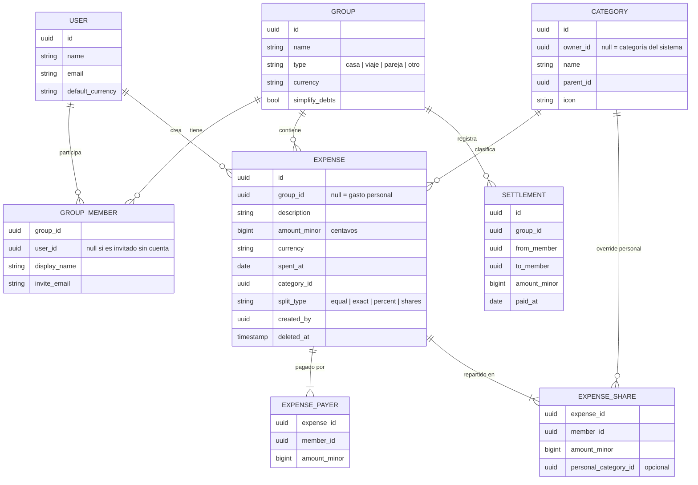

# Clear Accounts — Documento de diseño (v0.1)

> Estado: borrador inicial para discusión. Fecha: 2026-11-21.

## 1. Visión

Splitwise resuelve "¿quién le debe a quién?". Las apps de finanzas personales resuelven "¿en qué gasto mi plata?". Hoy hay que usar las dos y cargar todo dos veces.

**Clear Accounts une ambas preguntas con una sola carga**: cargás un gasto una vez y la app sabe (a) cómo se reparte en el grupo y (b) cuánto de eso es *tu* consumo real, por categoría.

## 2. Conceptos clave

| Concepto | Definición |
|---|---|
| **Usuario** | Persona con cuenta en la app. |
| **Grupo** | Conjunto de participantes que comparten gastos (casa, viaje, pareja). Tiene moneda por defecto. |
| **Gasto** | Un consumo con monto, fecha, categoría, quién pagó y cómo se reparte. Puede pertenecer a un grupo o no (personal). |
| **Pagador(es)** | Quién(es) pusieron la plata. Puede haber más de uno. |
| **Parte (share)** | Cuánto del gasto le corresponde consumir a cada participante. |
| **Liquidación (settlement)** | Pago entre participantes para saldar deudas. **No es un gasto**: es una transferencia. |
| **Balance** | Por participante: `lo que pagó − lo que consumió ± liquidaciones`. |

### La decisión central: el gasto personal es *tu parte*, no lo que pagaste

Ejemplo: cena de $30.000 entre 3, pagó Ana.

| | Ana | Beto | Vos |
|---|---|---|---|
| Pagó | 30.000 | 0 | 0 |
| Consumió (parte) | 10.000 | 10.000 | 10.000 |
| Balance | +20.000 | −10.000 | −10.000 |

En el registro personal de **cada uno** aparece "Restaurantes: $10.000", aunque solo Ana sacó la billetera. Cuando Beto le transfiere $10.000 a Ana, eso es una liquidación y **no** vuelve a contar como gasto (si no, contaríamos doble).

Así los reportes por categoría reflejan consumo real, y el flujo de caja (lo que efectivamente pagaste) se puede mostrar aparte.

## 3. Modelo de datos

Principio: **una sola fuente de verdad**. Un gasto personal es simplemente un gasto sin grupo, con un único participante. El "registro personal" no es una copia de los gastos de grupo: es una **vista** sobre todas las partes (`expense_shares`) del usuario. Cero duplicación, cero desincronización: si alguien edita el gasto en el grupo, tu registro personal se actualiza solo.



Detalles relevantes:

- **Montos en enteros (centavos)**. Nunca `float` para plata. Los redondeos de un reparto se asignan de forma determinística (ej.: el centavo sobrante va al pagador) para que `Σ partes = monto`.
- **Invariantes**: `Σ payers = amount` y `Σ shares = amount` en todo gasto.
- **`personal_category_id`**: el grupo cargó "Supermercado", pero vos querés verlo como "Hogar". Cada usuario puede recategorizar *su parte* sin tocar el gasto del grupo.
- **Miembros sin cuenta**: se puede agregar a alguien al grupo solo con nombre/email y que se una después; sus partes quedan vinculadas al `member_id`.
- **Borrado lógico** (`deleted_at`) + historial de cambios: en gastos compartidos, "¿quién cambió esto?" es una pregunta que va a aparecer.

## 4. Lógica de negocio

### 4.1 Tipos de reparto (MVP)
1. **Partes iguales** entre los seleccionados.
2. **Montos exactos** por persona.
3. **Porcentajes**.
4. **Proporciones** (ej.: 2 partes / 1 parte — útil en casa con distintos ingresos).

### 4.2 Balance y simplificación de deudas
- Balance neto por miembro = `Σ pagado − Σ partes + Σ liquidaciones enviadas − Σ liquidaciones recibidas`.
- **Simplificación**: algoritmo greedy que empareja el mayor deudor con el mayor acreedor hasta saldar. Produce como máximo `n−1` transferencias. Configurable por grupo (hay grupos que prefieren ver las deudas "originales").

### 4.3 Registro personal
Vista del usuario = todas sus `expense_shares` (de grupos + personales), con:
- Filtros por período, categoría, grupo, "solo personales / solo compartidos".
- Reportes: gasto por categoría, evolución mensual, top categorías.
- Indicador separado de **flujo de caja**: lo que pagaste vs. lo que consumiste.

## 5. Funcionalidades por fase

**MVP (v1)**
- Registro / login (email + Google/Apple).
- Grupos: crear, invitar por link, miembros sin cuenta.
- Gastos de grupo con los 4 tipos de reparto, un pagador.
- Gastos personales.
- Balances, simplificación y registro de liquidaciones.
- Registro personal con categorías y reporte mensual por categoría.
- Una moneda por grupo.

**v2**
- Múltiples pagadores en un gasto.
- Multi-moneda con tipo de cambio por gasto (clave para viajes).
- Gastos recurrentes (alquiler, servicios).
- Foto del ticket / adjuntos.
- Presupuestos por categoría y alertas.
- Modo offline con sincronización.
- Notificaciones push ("Ana agregó un gasto en Casa").

**v3 (para soñar en grande)**
- Lectura de tickets con IA (monto, comercio, categoría sugerida).
- Categorización automática por descripción.
- Integración con pagos (Mercado Pago / transferencia) para liquidar desde la app.
- Exportación (CSV/Excel) e importación desde Splitwise.

## 6. Arquitectura propuesta

| Capa | Propuesta | Por qué |
|---|---|---|
| App mobile | **React Native + Expo (TypeScript)** | Un código para iOS y Android, builds en la nube (EAS), ecosistema enorme. |
| Backend | **Supabase** (Postgres + Auth + Realtime + Storage) | Postgres relacional encaja perfecto con este modelo; Row Level Security para que cada uno vea solo sus grupos; realtime para ver gastos de otros al instante. Arranque rápido sin servidor propio. |
| Lógica de dominio | Paquete TypeScript compartido (`packages/core`) | Repartos, redondeos y balances testeados de forma unitaria, usables en app y backend. |
| Validaciones críticas | Funciones/constraints en Postgres | Las invariantes (`Σ shares = amount`) no pueden depender del cliente. |

Alternativa evaluada: Flutter + Firebase. Descartada como default porque Firestore (NoSQL) complica los balances y reportes agregados, que son el corazón de la app.

Estructura de repo sugerida (monorepo):

```
clear-accounts/
├── apps/mobile/          # Expo app
├── packages/core/        # dominio: splits, balances, simplificación (+ tests)
├── supabase/             # migraciones SQL, RLS, funciones
└── docs/
```

## 7. Pantallas principales (MVP)

1. **Inicio**: balance global ("te deben $X / debés $Y") + gasto del mes por categoría.
2. **Grupos**: lista con balance por grupo.
3. **Detalle de grupo**: gastos, balances, botón "Liquidar".
4. **Agregar gasto**: monto → descripción → categoría → grupo (o "Personal") → quién pagó → cómo se reparte. El flujo más usado: tiene que cargarse en menos de 10 segundos.
5. **Mis gastos**: registro personal con filtros.
6. **Reportes**: torta por categoría, barras por mes.
7. **Perfil / categorías / ajustes**.

## 8. Preguntas abiertas

1. **Stack**: ¿OK con React Native + Supabase, o hay preferencia/experiencia previa con otro?
2. **Moneda**: ¿multi-moneda entra en el MVP (viajes) o alcanza con una moneda por grupo?
3. **Categorías**: ¿lista fija del sistema, personalizables, o ambas? ¿Subcategorías?
4. **Privacidad**: ¿los demás miembros del grupo pueden ver tu recategorización personal? (Propuesta: no.)
5. **Offline**: ¿es requisito desde el día 1?
6. **Alcance**: ¿uso personal / familia y amigos, o producto público (implica legales, App Store, monetización)?
