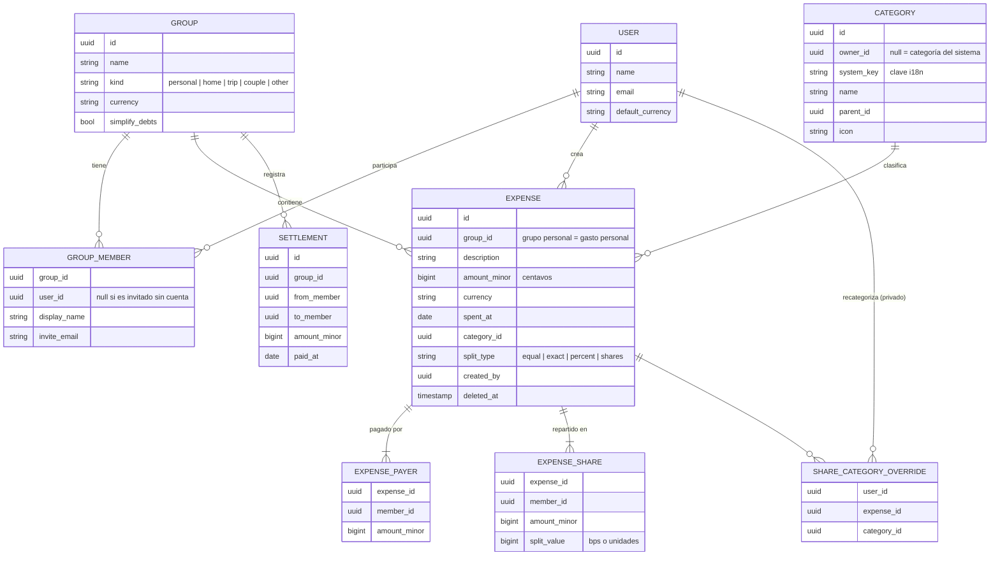

# Clear Accounts — Documento de diseño (v0.2)

> Estado: decisiones del MVP tomadas (ver §0). Fecha: 2026-11-21.

## 0. Decisiones tomadas

| # | Tema | Decisión |
|---|---|---|
| 1 | Stack | React Native + Expo (TypeScript) y Supabase (Postgres). |
| 2 | Moneda | Una moneda por grupo en el MVP. El modelo ya guarda moneda por gasto y los balances se calculan por moneda, así que multi-moneda (v2) no requiere migrar datos. |
| 3 | Categorías | Ambas: categorías del sistema (con subcategorías) + categorías propias de cada usuario. |
| 4 | Privacidad | La recategorización personal de un gasto de grupo es **privada**: el resto del grupo no la ve. |
| 5 | Offline | Fuera del MVP. El modelo queda preparado (UUIDs generados en el cliente, `updated_at` + `version`). |
| 6 | Alcance | MVP para familia y amigos; arquitectura lista para producto comercial público (ver §8). |
| 7 | Gasto personal | Se modela como gasto en el **grupo personal** del usuario (un grupo oculto de un solo miembro, creado al registrarse). Un único modelo, una única política de seguridad. |
| 8 | Redondeo | Método del resto mayor: los centavos sobrantes van a quien tenga mayor fracción (empate: orden de la lista). Determinístico y justo. |

## 1. Visión

Splitwise resuelve "¿quién le debe a quién?". Las apps de finanzas personales resuelven "¿en qué gasto mi plata?". Hoy hay que usar las dos y cargar todo dos veces.

**Clear Accounts une ambas preguntas con una sola carga**: cargás un gasto una vez y la app sabe (a) cómo se reparte en el grupo y (b) cuánto de eso es *tu* consumo real, por categoría.

## 2. Conceptos clave

| Concepto | Definición |
|---|---|
| **Usuario** | Persona con cuenta en la app. |
| **Grupo** | Conjunto de participantes que comparten gastos (casa, viaje, pareja). Tiene moneda por defecto. |
| **Gasto** | Un consumo con monto, fecha, categoría, quién pagó y cómo se reparte. Puede pertenecer a un grupo o no (personal). |
| **Pagador(es)** | Quién(es) pusieron la plata. Puede haber más de uno. |
| **Parte (share)** | Cuánto del gasto le corresponde consumir a cada participante. |
| **Liquidación (settlement)** | Pago entre participantes para saldar deudas. **No es un gasto**: es una transferencia. |
| **Balance** | Por participante: `lo que pagó − lo que consumió ± liquidaciones`. |

### La decisión central: el gasto personal es *tu parte*, no lo que pagaste

Ejemplo: cena de $30.000 entre 3, pagó Ana.

| | Ana | Beto | Vos |
|---|---|---|---|
| Pagó | 30.000 | 0 | 0 |
| Consumió (parte) | 10.000 | 10.000 | 10.000 |
| Balance | +20.000 | −10.000 | −10.000 |

En el registro personal de **cada uno** aparece "Restaurantes: $10.000", aunque solo Ana sacó la billetera. Cuando Beto le transfiere $10.000 a Ana, eso es una liquidación y **no** vuelve a contar como gasto (si no, contaríamos doble).

Así los reportes por categoría reflejan consumo real, y el flujo de caja (lo que efectivamente pagaste) se puede mostrar aparte.

## 3. Modelo de datos

Principio: **una sola fuente de verdad**. Un gasto personal es simplemente un gasto en el *grupo personal* del usuario (grupo de tipo `personal`, un solo miembro, invisible para el resto). El "registro personal" no es una copia de los gastos de grupo: es una **vista** sobre todas las partes (`expense_shares`) del usuario. Cero duplicación, cero desincronización: si alguien edita el gasto en el grupo, tu registro personal se actualiza solo.



Detalles relevantes:

- **Montos en enteros (centavos)**. Nunca `float` para plata. Los redondeos se asignan con el método del resto mayor para que `Σ partes = monto` siempre.
- **Invariantes**: `Σ payers = amount` y `Σ shares = amount` en todo gasto, y todos los participantes pertenecen al grupo del gasto. Se validan en el cliente (`packages/core`) **y** en la base (constraint triggers diferidos). La base es la autoridad final.
- **`share_category_overrides`**: el grupo cargó "Supermercado", pero vos querés verlo como "Hogar". Cada usuario recategoriza *su parte* sin tocar el gasto del grupo. Está en una tabla aparte con RLS de solo-dueño: nadie más la ve.
- **Escrituras atómicas**: un gasto se guarda con la RPC `save_expense(payload)` (gasto + pagadores + partes en una transacción).
- **Miembros sin cuenta**: se puede agregar a alguien al grupo solo con nombre/email y que se una después; sus partes quedan vinculadas al `member_id`.
- **Borrado lógico** (`deleted_at`) + `activity_log` automático: en gastos compartidos, "¿quién cambió esto?" es una pregunta que va a aparecer.

## 4. Lógica de negocio

### 4.1 Tipos de reparto (MVP)
1. **Partes iguales** entre los seleccionados.
2. **Montos exactos** por persona.
3. **Porcentajes**.
4. **Proporciones** (ej.: 2 partes / 1 parte — útil en casa con distintos ingresos).

### 4.2 Balance y simplificación de deudas
- Balance neto por miembro = `Σ pagado − Σ partes + Σ liquidaciones enviadas − Σ liquidaciones recibidas`.
- **Simplificación**: algoritmo greedy que empareja el mayor deudor con el mayor acreedor hasta saldar. Produce como máximo `n−1` transferencias. Configurable por grupo (hay grupos que prefieren ver las deudas "originales").

### 4.3 Registro personal
Vista del usuario = todas sus `expense_shares` (de grupos + personales), con:
- Filtros por período, categoría, grupo, "solo personales / solo compartidos".
- Reportes: gasto por categoría, evolución mensual, top categorías.
- Indicador separado de **flujo de caja**: lo que pagaste vs. lo que consumiste.

## 5. Funcionalidades por fase

**MVP (v1) — familia y amigos**
- Registro / login (email + Google/Apple).
- Grupos: crear, invitar por link, miembros sin cuenta.
- Gastos de grupo con los 4 tipos de reparto, un pagador.
- Gastos personales.
- Balances, simplificación y registro de liquidaciones.
- Registro personal con categorías (sistema + propias) y reporte mensual por categoría.
- Recategorización privada de tu parte.
- Una moneda por grupo.
- Español (con i18n preparado desde el día 1).

**v2 — beta pública**
- Múltiples pagadores en la UI (el modelo y la base ya lo soportan).
- Multi-moneda con tipo de cambio por gasto (clave para viajes).
- Gastos recurrentes (alquiler, servicios).
- Foto del ticket / adjuntos.
- Presupuestos por categoría y alertas.
- Modo offline con sincronización.
- Inglés, borrado de cuenta y exportación de datos (requisitos de tiendas y privacidad).
- Plan gratuito / premium y pase de viaje (ver §9).
- Notificaciones push ("Ana agregó un gasto en Casa").

**v3 (para soñar en grande)**
- Lectura de tickets con IA (monto, comercio, categoría sugerida).
- Categorización automática por descripción.
- Integración con pagos (Mercado Pago / transferencia) para liquidar desde la app.
- Exportación (CSV/Excel) e importación desde Splitwise.

## 6. Arquitectura propuesta

| Capa | Propuesta | Por qué |
|---|---|---|
| App mobile | **React Native + Expo (TypeScript)** | Un código para iOS y Android, builds en la nube (EAS), ecosistema enorme. |
| Backend | **Supabase** (Postgres + Auth + Realtime + Storage) | Postgres relacional encaja perfecto con este modelo; Row Level Security para que cada uno vea solo sus grupos; realtime para ver gastos de otros al instante. Arranque rápido sin servidor propio. |
| Lógica de dominio | Paquete TypeScript compartido (`packages/core`) | Repartos, redondeos y balances testeados de forma unitaria, usables en app y backend. |
| Validaciones críticas | Funciones/constraints en Postgres | Las invariantes (`Σ shares = amount`) no pueden depender del cliente. |

Alternativa evaluada: Flutter + Firebase. Descartada como default porque Firestore (NoSQL) complica los balances y reportes agregados, que son el corazón de la app.

Estructura del repo (monorepo con npm workspaces):

```
clear-accounts/
├── apps/mobile/          # app Expo
├── packages/core/        # dominio: repartos, balances, simplificación, registro personal (+ tests)
├── supabase/
│   ├── migrations/       # esquema, RLS, RPCs, vistas, categorías
│   └── tests/            # tests de la base con PGlite (sin Docker)
└── docs/
```

## 7. Pantallas principales (MVP)

1. **Inicio**: balance global ("te deben $X / debés $Y") + gasto del mes por categoría.
2. **Grupos**: lista con balance por grupo.
3. **Detalle de grupo**: gastos, balances, botón "Liquidar".
4. **Agregar gasto**: monto → descripción → categoría → grupo (o "Personal") → quién pagó → cómo se reparte. El flujo más usado: tiene que cargarse en menos de 10 segundos.
5. **Mis gastos**: registro personal con filtros.
6. **Reportes**: torta por categoría, barras por mes.
7. **Perfil / categorías / ajustes**.

## 8. Preparación para producto comercial

El MVP es para familia y amigos, pero estas decisiones se toman ahora porque cambiarlas después cuesta caro:

| Área | Ya en el diseño | Pendiente antes del lanzamiento público |
|---|---|---|
| **Seguridad** | RLS en todas las tablas; escrituras críticas vía RPC; invariantes en la base. | Auditoría de seguridad, rate limiting en RPCs, captcha en registro. |
| **Escalabilidad** | Postgres con índices por grupo/fecha/miembro; vistas agregadas. | Vistas materializadas o tablas de balance si los grupos crecen mucho. |
| **i18n** | `system_key` en categorías; `locale`, `timezone` y moneda por perfil; montos sin formato en la base. | Traducciones (en, pt), formatos regionales. |
| **Offline / sync** | UUIDs generables en el cliente, `updated_at`, `version`, borrado lógico. | Motor de sync (PowerSync / WatermelonDB) y resolución de conflictos. |
| **Ambientes** | Migraciones versionadas en el repo. | Proyectos Supabase separados: dev / staging / prod. CI/CD con EAS. |
| **Privacidad y legales** | Datos personales mínimos; recategorización privada. | Términos, política de privacidad, **borrado de cuenta** (obligatorio en App Store/Play: anonimizar el miembro y conservar los gastos del grupo), exportación de datos. |
| **Monetización** | — | Modelo freemium con `entitlements` chequeados en la base (no en el cliente) y compras in-app con RevenueCat. Ver §9. |
| **Observabilidad** | `activity_log` por grupo. | Sentry (errores), analytics con opt-in (PostHog), métricas de negocio. |
| **Calidad** | Tests de dominio y de base (RLS incluida) en CI. | Tests E2E de la app (Maestro). |

## 9. Monetización

> Estado: propuesta. Nada de esto se implementa antes de la beta pública (v2).

### 9.1 Principio rector: lo de grupos no se cobra

La app crece por invitaciones: cada grupo nuevo suma 3–4 personas. Cobrar por cargar, repartir o saldar gastos de grupo frena ese crecimiento (es el error que cometió Splitwise al limitar gastos diarios en su plan gratis). Por eso:

- **Gratis para siempre:** todo lo necesario para compartir gastos en grupo y llevar el registro personal básico.
- **Premium:** lo que nos diferencia (inteligencia sobre tus finanzas personales) y lo que cuesta mantener (IA, almacenamiento).
- **Nunca se retienen datos:** al bajar de plan no se pierde nada (ver §9.6). La exportación completa de datos es gratis (requisito de privacidad y de tiendas). Premium agrega reportes con formato.

### 9.2 Qué incluye cada plan

| Función | Gratis | Premium | Alcance |
|---|---|---|---|
| Grupos, miembros, invitaciones | Ilimitados | Ilimitados | — |
| Gastos de grupo y personales | Ilimitados | Ilimitados | — |
| Los 4 tipos de reparto, balances, simplificación, pagos | ✓ | ✓ | — |
| Reporte mensual por categoría | ✓ | ✓ | — |
| Exportación completa de datos (CSV/JSON) | ✓ | ✓ | — |
| Categorías propias | Hasta 5 | Ilimitadas | Usuario |
| Reportes avanzados (tendencias, comparativas mes a mes, por grupo) | — | ✓ | Usuario |
| Presupuestos por categoría y alertas | — | ✓ | Usuario |
| Gastos recurrentes | — | ✓ | Usuario |
| Lectura de tickets y categorización automática con IA | — | ✓ (con límite mensual razonable) | Usuario |
| Exportación a Excel con formato | — | ✓ | Usuario |
| Multi-moneda con tipo de cambio por gasto | — | ✓ | **Grupo** |
| Foto del ticket / adjuntos en gastos | — | ✓ | **Grupo** |

**Alcance "Grupo" = premium compartido:** si al menos un miembro del grupo tiene Premium (o hay un pase de viaje activo en ese grupo), la función se habilita para **todos** los miembros de ese grupo. Así, quien no paga prueba Premium sin costo, lo que empuja la conversión y las invitaciones.

### 9.3 Productos y precios (a validar)

| Producto | Precio de referencia | Notas |
|---|---|---|
| Premium mensual | USD 2,49 | Precio regional en las tiendas (ARS, BRL, etc.). |
| Premium anual | USD 19,99 (≈ 33 % de descuento) | Plan destacado. Prueba gratis de 7 días. |
| Pase de viaje | USD 4,99 por grupo, 30 días | Compra única. Activa las funciones de alcance "Grupo" en un grupo puntual. Ideal para viajes, el momento de mayor uso. |
| Premium de por vida | USD 49,99 | **Solo por tiempo limitado al lanzar**, para premiar a los primeros usuarios y conseguir caja temprana. |

Comisiones de tienda: 15 % (Apple Small Business Program y Google Play, mientras se facture menos de USD 1M al año).

### 9.4 Modelo de datos y seguridad

Los permisos se calculan **en la base**, nunca en el cliente: el cliente solo los lee para mostrar u ocultar la interfaz.

```sql
create type entitlement_source as enum ('subscription', 'lifetime', 'trip_pass', 'promo');

-- Lo que el usuario compró o recibió. Solo lo escribe el backend (service role).
create table entitlements (
  id               uuid primary key default gen_random_uuid(),
  user_id          uuid not null references profiles (id) on delete cascade,
  source           entitlement_source not null,
  group_id         uuid references groups (id) on delete cascade, -- solo trip_pass
  product_id       text not null,           -- id del producto en la tienda / RevenueCat
  store            text,                    -- 'app_store' | 'play_store' | 'promo'
  starts_at        timestamptz not null default now(),
  expires_at       timestamptz,             -- null = no vence (lifetime)
  revoked_at       timestamptz,             -- reembolsos
  created_at       timestamptz not null default now(),
  updated_at       timestamptz not null default now(),
  check ((source = 'trip_pass') = (group_id is not null))
);

-- Eventos del webhook ya procesados (idempotencia).
create table billing_events (
  event_id    text primary key,
  payload     jsonb not null,
  received_at timestamptz not null default now()
);
```

- **RLS:** cada usuario solo puede leer sus filas de `entitlements`. Nadie escribe desde el cliente. `billing_events` no es accesible desde el cliente.
- **`is_premium(p_user uuid) returns boolean`:** hay un entitlement de usuario (no `trip_pass`) vigente y no revocado.
- **`can_use(p_feature text, p_group uuid default null) returns boolean`** (security definer, stable): decide según el alcance de la función.
  - Alcance usuario: `is_premium(auth.uid())`.
  - Alcance grupo: algún miembro de `p_group` es premium **o** hay un `trip_pass` vigente para `p_group`.
- **Dónde se aplica:**
  - `save_expense` rechaza una moneda distinta a la del grupo si `can_use('multi_currency', group)` es falso.
  - Un trigger en `categories` limita a 5 las categorías propias sin Premium.
  - Los RPCs de IA, presupuestos y recurrentes chequean `can_use` al entrar.
- **Interruptor general:** un flag de configuración `billing_enforced` (desactivado por defecto) hace que `can_use` devuelva siempre `true`. Permite tener la infraestructura en producción y medir el uso antes de activar el cobro.

### 9.5 Flujo de compra

1. La app usa el **SDK de RevenueCat** (compatible con Expo vía development build) con `app_user_id` igual al `id` de Supabase del usuario.
2. La compra la procesa la tienda. RevenueCat la valida.
3. RevenueCat llama a una **Edge Function** (`billing-webhook`) que verifica el header secreto, descarta eventos repetidos (`billing_events`) y crea o actualiza `entitlements` (alta, renovación, cancelación, vencimiento, reembolso).
4. La app escucha cambios en `entitlements` por Realtime (o refresca al volver) y actualiza la interfaz.
5. **"Restaurar compras"** visible en Perfil (requisito de App Store).

### 9.6 Al bajar de plan

- Los datos creados con Premium **no se borran ni se ocultan**: los gastos multi-moneda y los adjuntos siguen visibles, y la exportación completa sigue disponible.
- Lo que se pausa: crear nuevos gastos multi-moneda o adjuntos, la generación automática de recurrentes, las alertas de presupuesto y la IA.
- Las categorías propias por encima del tope siguen existiendo y usables. Solo no se pueden crear nuevas.

### 9.7 Lo que descartamos

| Opción | Por qué no |
|---|---|
| Publicidad | Anuncios al lado de datos financieros generan desconfianza. Con pocos usuarios rinde centavos. |
| Vender datos agregados | Aunque sean anónimos, rompe la confianza, que es todo el producto. |
| Limitar gastos de grupo | Frena el crecimiento por invitaciones (§9.1). |

**Para más adelante (v3+):** liquidar con Mercado Pago desde la app (más retención que ingreso, con temas regulatorios), afiliados financieros transparentes (billeteras, tarjetas para viajes) y planes para grupos estables (casas compartidas, consorcios, clubes) con roles y reportes para administradores.

### 9.8 Fases y métricas

| Fase | Qué se hace | Qué se mide |
|---|---|---|
| **MVP (hoy)** | Nada. Familia y amigos. | Uso real, retención. |
| **v2 beta** | Tablas, `can_use`, webhook y paywall construidos, con `billing_enforced` apagado. Eventos de analytics por función Premium. | Qué funciones Premium se usan más, y quiénes las usan. |
| **Lanzamiento Premium** | Encender el cobro. Prueba de 7 días en el anual. Por vida solo en la ventana de lanzamiento. Pase de viaje junto con multi-moneda. | Conversión a pago (objetivo: 2–5 % de usuarios activos), retención a 30 días, invitaciones por usuario (no debe bajar), ingreso mensual recurrente, cancelaciones. |

**Decisiones pendientes:** precios finales por región, duración de la prueba, tope de categorías gratis y límite mensual de IA (según el costo real por ticket).

## 10. Estado y próximos pasos

**Hecho**
- Dominio (`packages/core`), esquema + RLS + RPCs (`supabase/`), con tests.
- App Expo con login, grupos, invitaciones por link, miembros sin cuenta, carga de gastos (4 tipos de reparto), balances con "cómo saldar" y registro de pagos, "Mis gastos" con reporte mensual por categoría, tema claro/oscuro.
- v0.4: build Android con EAS (perfil `preview`: APK de distribución interna; `production`: AAB para Play Store), actualizaciones por el aire con EAS Update (canal por perfil, runtime por fingerprint, aviso para aplicar), variables de entorno en EAS, ícono propio, fecha del gasto (hoy / ayer / calendario).
- v0.3: pagos con monto editable (vista previa de cómo queda cada saldo; pagar de más invierte la deuda) y pagos visibles/eliminables en el historial del grupo; actualización en tiempo real (Supabase Realtime, respeta RLS) y al volver a la app; imágenes circulares de grupo y de perfil en Storage privado con URLs firmadas (acceso por RLS: miembros del grupo / dueño y quienes comparten grupo).
- v0.2 de la app: menú inferior siempre visible (una pila por pestaña), detalle de gasto con edición y borrado, detalle de "Te deben" / "Debés" por persona, perfil editable (nombre y email), edición de miembros (renombrar invitados, quitar solo con saldo cero, regla aplicada en la base), deslizar para actualizar, orden por fecha y momento de carga.

**Próximos pasos**
1. Crear el proyecto Supabase (dev) y probar la app con usuarios reales vía Expo Go.
3. Categorías propias del usuario y recategorización privada desde la UI.
4. Login con Google / Apple.
5. Build interna con EAS (TestFlight / Play Internal Testing) para familia y amigos.
