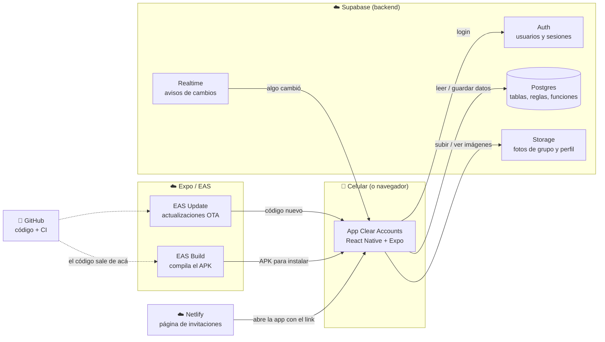
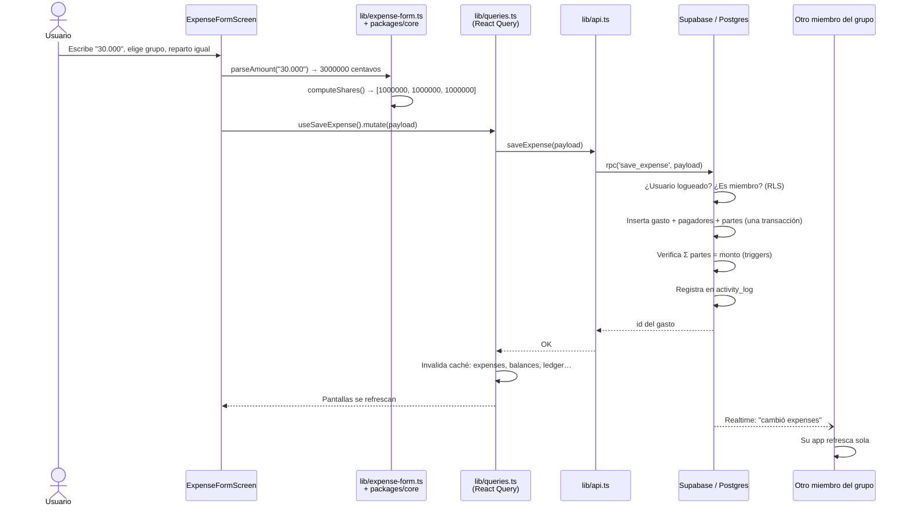
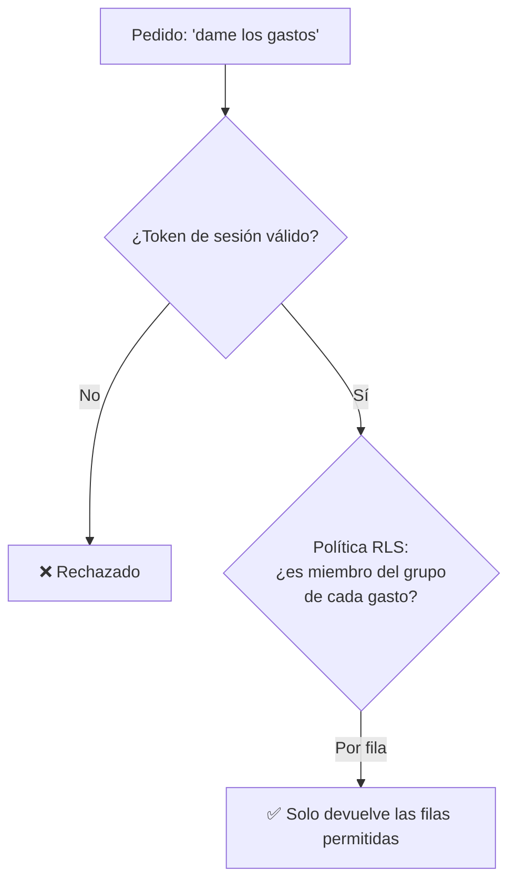
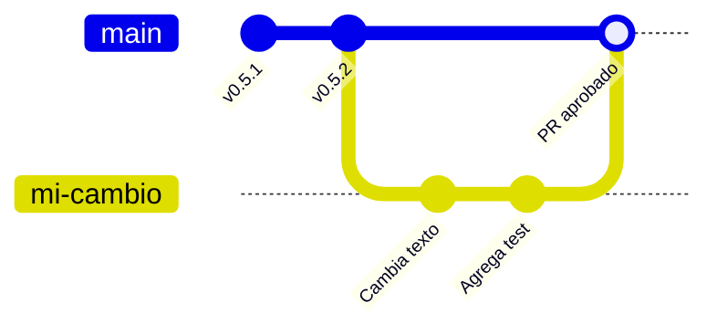
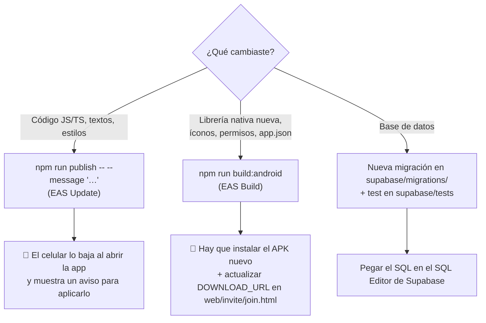

# Guía del proyecto Clear Accounts

> **Para quién es:** alguien que quiere entender cómo está armado este proyecto (y aprender programación con él) sin tener experiencia previa con TypeScript, React Native, Expo o Supabase.
>
> **Cómo leerla:** de arriba hacia abajo la primera vez. Después sirve como referencia: cada sección se entiende sola.
>
> Documentos relacionados: [README.md](../README.md) (arranque rápido) · [DESIGN.md](DESIGN.md) (decisiones de producto y modelo de datos) · [apps/mobile/README.md](../apps/mobile/README.md) (correr y publicar la app).

---

## Índice

1. [Qué hace la app](#1-qué-hace-la-app)
2. [El mapa general: cómo se conectan las piezas](#2-el-mapa-general-cómo-se-conectan-las-piezas)
3. [Las herramientas, una por una](#3-las-herramientas-una-por-una)
4. [Recorrido por las carpetas](#4-recorrido-por-las-carpetas)
5. [Un viaje completo: qué pasa cuando cargás un gasto](#5-un-viaje-completo-qué-pasa-cuando-cargás-un-gasto)
6. [Seguridad: quién puede ver qué](#6-seguridad-quién-puede-ver-qué)
7. [Tests: cómo sabemos que funciona](#7-tests-cómo-sabemos-que-funciona)
8. [Cómo hacer cambios y que queden versionados](#8-cómo-hacer-cambios-y-que-queden-versionados)
9. [Cómo llega un cambio al celular](#9-cómo-llega-un-cambio-al-celular)
10. [Recetas para cambios comunes](#10-recetas-para-cambios-comunes)
11. [Técnicas de programación para aprender de este proyecto](#11-técnicas-de-programación-para-aprender-de-este-proyecto)
12. [Glosario](#12-glosario)
13. [Ejercicios sugeridos](#13-ejercicios-sugeridos)

---

## 1. Qué hace la app

Clear Accounts responde dos preguntas con **una sola carga de datos**:

| Pregunta | Ejemplo | Lo que hacía falta antes |
|---|---|---|
| ¿Quién le debe a quién? | "Beto le debe $10.000 a Ana por la cena." | Una app tipo Splitwise. |
| ¿En qué gasto mi plata? | "Este mes gasté $45.000 en restaurantes." | Una app de finanzas personales. |

### Funciones principales

- **Cuenta de usuario**: registro y login con email y contraseña.
- **Grupos** (casa, viaje, pareja…): se crean, se invita gente por link o QR, se pueden agregar miembros que todavía no tienen cuenta.
- **Gastos**: monto, descripción, fecha, categoría, quién pagó y cómo se reparte. Cuatro formas de repartir: partes iguales, montos exactos, porcentajes o proporciones (ej. 2 a 1).
- **Balances y "cómo saldar"**: la app calcula cuánto debe o le deben a cada uno y propone la menor cantidad de transferencias para quedar en cero.
- **Pagos (liquidaciones)**: registrar "le pagué a Ana". No es un gasto, es una transferencia.
- **Mis gastos (registro personal)**: todos tus consumos (personales y tu parte de los grupales), con buscador, filtros y comparación con el mes anterior.
- **Categorías propias** y **recategorización privada**: el grupo cargó "Supermercado", vos lo ves como "Hogar" y nadie más se entera.
- **Tiempo real**: si alguien carga un gasto en tu grupo, tu pantalla se actualiza sola.
- **Actualizaciones por el aire**: los cambios de código llegan al celular sin reinstalar la app.

### La idea central (vale la pena entenderla bien)

Cena de $30.000 entre 3, pagó Ana:

| | Ana | Beto | Vos |
|---|---|---|---|
| Pagó | 30.000 | 0 | 0 |
| Consumió (su parte) | 10.000 | 10.000 | 10.000 |
| **Balance** | **+20.000** | **−10.000** | **−10.000** |

En el registro personal de **cada uno** aparece "Restaurantes: $10.000". Tu gasto personal es **lo que consumiste**, no lo que pagaste. Y un **gasto personal** es simplemente un gasto en un grupo oculto de un solo miembro (tu "grupo personal"), así todo usa el mismo modelo de datos.

---

## 2. El mapa general: cómo se conectan las piezas



En palabras:

- **La app** corre en el celular. Muestra pantallas y le pide datos a Supabase.
- **Supabase** es el "servidor": guarda los datos en una base Postgres, maneja usuarios, avisa cambios en tiempo real y guarda imágenes. **No hay un servidor propio escrito por nosotros**: la lógica que tiene que ser segura vive *dentro* de la base de datos (reglas y funciones SQL).
- **Expo/EAS** compila la app y distribuye actualizaciones.
- **Netlify** sirve una página web mínima para que los links de invitación abran la app.
- **GitHub** guarda el código, su historia, y corre los tests automáticamente en cada cambio.

---

## 3. Las herramientas, una por una

Para cada herramienta: **qué es**, **para qué se usa acá** y **dónde la ves**.

### 3.1 Lenguajes

| Herramienta | Qué es | Para qué se usa acá | Dónde |
|---|---|---|---|
| **TypeScript** | JavaScript con *tipos*: le decís al código "esta variable es un número" y te avisa antes de ejecutar si te equivocás. | Todo el código de la app y de la lógica de dominio. | Archivos `.ts` y `.tsx` |
| **TSX** | TypeScript que además permite escribir "etiquetas" tipo HTML para describir pantallas. | Pantallas y componentes visuales. | Archivos `.tsx` |
| **SQL** | El lenguaje de las bases de datos relacionales. | Crear tablas, reglas de seguridad, funciones y vistas. | `supabase/migrations/*.sql` |
| **HTML/CSS/JS** | El trío clásico de la web. | La página de invitaciones. | `web/invite/` |

> 💡 **Por qué tipos:** en `packages/core/src/types.ts` hay definiciones como `MinorUnits` (montos en centavos). Si alguien intenta pasar un texto donde va un monto, TypeScript lo marca en rojo antes de que el error llegue a un usuario.

### 3.2 Herramientas de base (el "taller")

| Herramienta | Qué es | Para qué se usa acá |
|---|---|---|
| **Node.js** (v22) | Programa que ejecuta JavaScript fuera del navegador. | Correr tests, el servidor de desarrollo de Expo y las herramientas de línea de comandos. |
| **npm** | El gestor de paquetes de Node: descarga librerías de terceros. | Instalar dependencias (`npm ci`) y correr scripts (`npm test`). |
| **`package.json`** | La "ficha" de un proyecto: nombre, versión, dependencias y comandos. | Hay uno en la raíz y uno por cada sub-proyecto. |
| **`package-lock.json`** | Foto exacta de *qué versión* de cada librería se instaló. | Garantiza que tu máquina, la de otro y GitHub instalen exactamente lo mismo. Por eso se usa `npm ci` (respeta el lock) y no `npm install` (puede modificarlo). |
| **npm workspaces** | Permite tener varios proyectos en un solo repositorio (*monorepo*). | La raíz declara `packages/*`, `apps/*` y `supabase` como sub-proyectos. Un `npm test` en la raíz corre los tests de los tres. |
| **`tsconfig.json`** | Configuración de TypeScript (qué tan estricto es). | `tsconfig.base.json` usa modo estricto + `noUncheckedIndexedAccess` (te obliga a contemplar que un elemento de una lista puede no existir). |

### 3.3 La app mobile

| Herramienta | Qué es | Para qué se usa acá |
|---|---|---|
| **React** | Librería para construir interfaces con *componentes*: piezas reutilizables que se redibujan solas cuando cambian sus datos. | Toda la UI. |
| **React Native** | React, pero en vez de dibujar HTML dibuja componentes nativos de Android/iOS (`<View>`, `<Text>`, `<Pressable>`). | Que la app sea una app real de celular. |
| **react-native-web** | Traduce esos componentes a HTML. | Poder probar la app en el navegador (tecla `w`). |
| **Expo** (SDK 58) | Un "kit" sobre React Native: librerías listas (cámara, imágenes, fechas, actualizaciones) y herramientas para compilar sin Android Studio. | Base de toda la app. `app.json` es su configuración. |
| **Expo Go** | App que instalás en el celular para probar tu código al instante, escaneando un QR. | Desarrollo diario. |
| **Expo Router** | Navegación basada en archivos: **cada archivo en `src/app/` es una pantalla**, y la ruta de la carpeta es la URL. | Toda la navegación (pestañas, modales, links de invitación). |
| **TanStack React Query** | Maneja datos que vienen del servidor: los pide, los guarda en memoria (*caché*), sabe cuándo están viejos y los vuelve a pedir. | `src/lib/queries.ts`. Evita pedir lo mismo mil veces y mantiene la pantalla al día. |
| **supabase-js** | La librería cliente para hablar con Supabase. | `src/lib/supabase.ts` crea el cliente; `src/lib/api.ts` lo usa. |
| **AsyncStorage** | Almacenamiento simple en el celular. | Guardar la sesión para no tener que loguearse cada vez. |
| **qrcode-generator** | Genera códigos QR en JavaScript puro. | Mostrar el QR de invitación. |

### 3.4 Backend: Supabase

Supabase es un "backend como servicio": te da una base de datos Postgres con todo lo de alrededor ya resuelto.

| Pieza | Qué hace | En este proyecto |
|---|---|---|
| **Postgres** | Base de datos relacional: tablas con filas y columnas, relacionadas entre sí. | `profiles`, `groups`, `group_members`, `expenses`, `expense_payers`, `expense_shares`, `settlements`, `categories`, etc. |
| **Auth** | Registro, login y tokens de sesión. | Al crear un usuario, un *trigger* le crea su perfil y su grupo personal. |
| **RLS (Row Level Security)** | Reglas *dentro* de la base que deciden qué filas puede ver o modificar cada usuario. | Cada tabla tiene políticas tipo "solo ves gastos de grupos donde sos miembro". |
| **RPC (funciones)** | Funciones SQL que la app llama como si fueran una API. | `save_expense`, `create_group`, `accept_invite`… Guardan varias cosas juntas en una sola transacción. |
| **PostgREST** | Convierte las tablas en una API web automáticamente. | Lo usa `supabase.from('groups').select(...)` por debajo. |
| **Realtime** | Avisa a la app cuando cambian filas. | `src/lib/realtime.ts`: si cambia un gasto, se refresca la pantalla. |
| **Storage** | Guarda archivos (imágenes). | Bucket privado `images` con URLs firmadas que vencen. |

### 3.5 Calidad

| Herramienta | Qué es | Para qué se usa acá |
|---|---|---|
| **Vitest** | Framework de tests: ejecuta funciones de prueba y compara resultados esperados con reales. | Tests en `packages/core/test`, `apps/mobile/test` y `supabase/tests`. |
| **PGlite** | Postgres compilado a WebAssembly: una base Postgres real que corre dentro de Node, sin instalar nada. | Los tests de base de datos aplican todas las migraciones y prueban RLS y funciones. |
| **`tsc --noEmit`** (typecheck) | El compilador de TypeScript, en modo "solo revisar". | Detecta errores de tipos en todo el código. |
| **GitHub Actions** | Robots de GitHub que corren comandos ante cada cambio. | `.github/workflows/ci.yml`: en cada `push` instala, hace typecheck y corre todos los tests. |

### 3.6 Distribución

| Herramienta | Qué es | Para qué se usa acá |
|---|---|---|
| **EAS Build** | Servicio de Expo que compila la app en la nube. | Genera el APK de Android (`npm run build:android`). |
| **EAS Update** | Envía cambios de JavaScript a apps ya instaladas ("over the air", OTA). | `npm run publish`: el celular baja el código nuevo al abrir la app. |
| **Fingerprint / runtime** | Una "huella" calculada a partir de la parte nativa de la app. | Decide si un update OTA es compatible con el APK instalado. Si cambia la huella, hace falta un APK nuevo. |
| **Netlify** | Hosting de sitios estáticos. | Sirve `web/invite/`: el link `https://…/j/<token>` abre la app o lleva a la descarga. |

### 3.7 Versionado

| Herramienta | Qué es | Para qué se usa acá |
|---|---|---|
| **Git** | Sistema de control de versiones: guarda la historia completa de cada archivo y permite volver atrás. | Todo el proyecto. `git log` muestra cada cambio con su explicación. |
| **GitHub** | Servicio que aloja repositorios Git en la nube y agrega colaboración (Pull Requests, CI). | Repositorio `arielmik/clear-accounts`. |
| **`.gitignore`** | Lista de archivos que Git **no** debe guardar. | `node_modules/` (se reinstala), `.env` (tiene claves), `.expo/` (caché). |
| **`.gitattributes`** | Reglas de Git por tipo de archivo. | Normaliza finales de línea entre Windows y Linux. |

---

## 4. Recorrido por las carpetas

```
clear-accounts/
├── package.json              ← raíz del monorepo: declara los workspaces y los comandos globales
├── package-lock.json         ← versiones exactas instaladas (no se edita a mano)
├── tsconfig.base.json        ← reglas de TypeScript compartidas
├── .github/workflows/ci.yml  ← el robot que corre tests en cada push
├── docs/                     ← documentación (DESIGN.md y esta guía)
│
├── packages/core/            ← 🧠 LÓGICA DE NEGOCIO PURA (sin pantallas, sin base de datos)
├── apps/mobile/              ← 📱 LA APP
├── supabase/                 ← 🗄️ LA BASE DE DATOS
└── web/invite/               ← 🌐 PÁGINA DE INVITACIONES
```

### 4.1 `packages/core/` — el cerebro

Funciones que calculan cosas, sin depender de pantallas ni de internet. Son las más fáciles de entender y testear: **empezá a leer por acá**.

| Archivo | Qué contiene |
|---|---|
| `src/types.ts` | Definiciones de tipos: `MinorUnits`, `Share`, `Expense`, `Settlement`, `Transfer`… |
| `src/money.ts` | `allocate()`: reparte un monto en partes **sin perder ni inventar un centavo** (método del resto mayor). |
| `src/splits.ts` | `computeShares()`: convierte "igual / exacto / porcentaje / proporciones" en montos concretos por persona. |
| `src/validation.ts` | Verifica las invariantes de un gasto (lo pagado y lo repartido suman el total). |
| `src/balances.ts` | Calcula el balance de cada miembro y `simplifyDebts()`: el mínimo de transferencias para saldar. |
| `src/ledger.ts` | Lógica del registro personal. |
| `src/errors.ts` | `DomainError`: errores con código (`SPLIT_MISMATCH`, `INVALID_AMOUNT`…). |
| `src/index.ts` | Re-exporta todo, así otros importan desde `@clear-accounts/core`. |
| `test/*.test.ts` | Un archivo de tests por tema. |

### 4.2 `apps/mobile/` — la app

```
apps/mobile/
├── app.json              ← configuración de Expo: nombre, versión, íconos, esquema de links (clearaccounts://)
├── eas.json              ← perfiles de compilación: preview (APK) y production (AAB para Play Store)
├── fingerprint.config.js ← ajuste de la huella para que dé igual en Windows y Linux
├── .env.example          ← plantilla de variables (URL y clave pública de Supabase)
├── assets/               ← íconos y splash
├── test/                 ← tests de la lógica de la app
└── src/
    ├── app/              ← RUTAS (Expo Router): cada archivo = una pantalla
    ├── screens/          ← el contenido real de cada pantalla
    ├── components/       ← piezas visuales reutilizables
    ├── lib/              ← lógica: datos, montos, fechas, sesión, tiempo real
    └── i18n/             ← todos los textos de la app
```

#### `src/app/` — las rutas

Expo Router convierte la estructura de carpetas en navegación:

| Archivo | Pantalla / ruta |
|---|---|
| `_layout.tsx` | El "marco" de toda la app: providers (sesión, caché de datos), y **qué pantallas se ven con o sin sesión** (`Stack.Protected`). Si faltan las variables de Supabase, muestra una pantalla de ayuda. |
| `login.tsx` | Ingreso / registro. |
| `(tabs)/_layout.tsx` | El menú inferior con 4 pestañas + el botón flotante "+" para cargar un gasto. |
| `(tabs)/(home)/` | Inicio, detalle de gasto, "Te deben" / "Debés". |
| `(tabs)/groups/` | Lista de grupos → detalle del grupo (`[id].tsx`) → detalle de gasto. |
| `(tabs)/ledger/` | Mis gastos. |
| `(tabs)/profile/` | Perfil, Mis categorías y Mis medios de pago. |
| `expense-form.tsx`, `group-form.tsx`, `settle-form.tsx`, `invite.tsx` | Modales (se abren encima). |
| `join/[token].tsx` | Se abre con el link de invitación `clearaccounts://join/<token>`. |

Convenciones de nombres:
- **`(nombre)`** entre paréntesis: agrupa rutas sin aparecer en la URL.
- **`[id]`** entre corchetes: parte variable de la ruta (`/groups/abc123` → `id = "abc123"`).
- **`_layout.tsx`**: define cómo se navega entre las pantallas de esa carpeta.

> 💡 Los archivos de `app/` son de una línea: `export { default } from '../../../screens/GroupsScreen';`. Separan **"dónde está"** (ruta) de **"qué es"** (pantalla). Así una misma pantalla se reutiliza en varias pestañas (el detalle de gasto aparece en Inicio, Grupos y Mis gastos).

#### `src/screens/` — las pantallas

`HomeScreen`, `GroupsScreen`, `GroupDetailScreen`, `ExpenseFormScreen`, `ExpenseDetailScreen`, `DebtsScreen`, `SettleFormScreen`, `LedgerScreen`, `ProfileScreen`, `CategoriesScreen`, `InviteScreen`, `GroupFormScreen`. Cada una combina datos (de `lib/queries.ts`) con componentes visuales.

#### `src/components/` — piezas reutilizables

| Archivo | Qué es |
|---|---|
| `theme.ts` | Colores (claro/oscuro) y espaciados. Cambiás un color acá y cambia en toda la app. |
| `ui.tsx` | Bloques básicos: `Screen`, `Card`, `Button`, `Title`, `Loading`, `ErrorState`, `Empty`… |
| `Money.tsx` | Muestra un monto formateado (con signo y color si corresponde). |
| `Avatar.tsx` | Imagen circular de grupo o perfil. |
| `CategoryPicker.tsx`, `DateField.tsx` (+ `.web.tsx`), `LedgerList.tsx`, `QrCode.tsx`, `AuthForm.tsx`, `UpdateBanner.tsx`, `TabStack.tsx` | Componentes específicos. |

> 💡 `DateField.tsx` y `DateField.web.tsx`: Expo elige automáticamente la versión `.web` cuando corre en el navegador. Así se resuelven diferencias entre plataformas sin `if`.

#### `src/lib/` — la lógica de la app

| Archivo | Responsabilidad |
|---|---|
| `supabase.ts` | Crea **el** cliente de Supabase a partir de las variables de entorno. |
| `auth.tsx` | Contexto de sesión: quién está logueado (`useAuth`, `useUserId`). |
| `api.ts` | **Todas** las llamadas a Supabase (`fetchGroups`, `saveExpense`…). Única puerta al backend. |
| `queries.ts` | *Hooks* de React Query (`useGroups`, `useSaveExpense`…) que envuelven a `api.ts` y manejan caché e invalidación. |
| `realtime.ts` | Escucha cambios de la base y refresca datos. |
| `money.ts` | Convierte lo que escribe el usuario (`"1.234,56"`) en centavos y viceversa. |
| `expense-form.ts` | Arma el *payload* de un gasto a partir del formulario (usa `computeShares` de core). |
| `debts.ts`, `settle.ts`, `ledger.ts`, `ledger-filters.ts`, `activity.ts` | Cálculos para las pantallas. |
| `images.ts`, `base64.ts` | Subir y mostrar imágenes. |
| `invite.ts`, `qr.ts` | Links de invitación y QR. |
| `updates.ts` | Buscar actualizaciones OTA al volver a la app. |
| `dates.ts`, `categories.ts`, `nav.ts`, `confirm.ts`, `errors.ts`, `types.ts` | Utilidades varias y tipos de las filas de la base. |

#### `src/i18n/` — textos

`es.ts` tiene **todos** los textos visibles. Las pantallas nunca escriben texto directo: usan `t.groups.title`. Cuando se agregue inglés, alcanza con un `en.ts`.

### 4.3 `supabase/` — la base de datos

```
supabase/
├── migrations/   ← cambios a la base, en orden cronológico (el nombre empieza con fecha y hora)
└── tests/
    ├── db.test.ts       ← tests de tablas, RLS y funciones con PGlite
    └── auth-stub.sql    ← simula el esquema "auth" de Supabase para poder testear localmente
```

Las **migraciones** son la historia de la base de datos:

| Migración | Qué hace |
|---|---|
| `…21000000_init.sql` | Crea todo: tablas, triggers, RLS, funciones (`save_expense`…), vistas (`my_ledger`, `group_balances`). |
| `…21000100_seed_categories.sql` | Carga las categorías del sistema. |
| `…22000000_grants.sql` | Permisos explícitos para los roles de la API. |
| `…22000100_members_profile.sql` | Edición de perfil y miembros. |
| `…22000200_images_realtime.sql` | Bucket de imágenes y activación de tiempo real. |
| `…22000300_fix_payment_dates.sql` | Corrección de fechas de pagos. |
| `…22000400_hardening.sql` | Endurecimiento según recomendaciones de Supabase. |
| `…23000000_categories_delete_group.sql` | Categorías propias y eliminar grupos. |
| `…23000100_revoke_anon.sql` | Quita permisos de ejecución al rol anónimo. |

> ⚠️ **Regla de oro:** una migración ya aplicada **no se edita**. Si hay que corregir algo, se crea una migración nueva. Así cualquier base (la real, la de tests, una futura de staging) llega al mismo estado aplicando los archivos en orden.

### 4.4 `web/invite/` — página de invitaciones

| Archivo | Qué es |
|---|---|
| `index.html` | Portada del sitio. |
| `join.html` | Recibe `/j/<token>`: en Android intenta abrir la app; si no está instalada, ofrece descargar el APK. |
| `_redirects` | Le dice a Netlify que `/j/*` sirva `join.html`. |
| `_headers` | Cabeceras de seguridad (no indexar, no filtrar el token). |
| `netlify.toml` | Configuración de Netlify (sitio estático, sin compilación). |

---

## 5. Un viaje completo: qué pasa cuando cargás un gasto

Seguir un dato de punta a punta es la mejor forma de entender una arquitectura.



Puntos clave:

1. **El monto se convierte a centavos enteros** apenas entra (`lib/money.ts`). Nunca se usa `0.1 + 0.2` con plata.
2. **El reparto se calcula en el cliente** con `packages/core`, para mostrar la vista previa al instante.
3. **La base vuelve a validar todo.** El cliente puede tener bugs o ser manipulado; la base es la autoridad final.
4. **Una sola llamada guarda todo junto** (`save_expense`): o se guarda el gasto completo o no se guarda nada.
5. **Después de guardar, se invalida la caché** y React Query vuelve a pedir lo que cambió.
6. **Los demás se enteran por Realtime**, que respeta RLS: solo reciben avisos de lo que pueden ver.

---

## 6. Seguridad: quién puede ver qué

La app usa una **clave pública** (`sb_publishable_…`) que viaja dentro del APK: cualquiera podría extraerla. Por eso **la seguridad no puede depender de la app**; vive en la base.



Capas de defensa (de afuera hacia adentro):

| Capa | Dónde | Ejemplo |
|---|---|---|
| Autenticación | Supabase Auth | Sin sesión, no hay datos. |
| Permisos por rol | Migraciones (`grant` / `revoke`) | El rol `anon` (no logueado) no puede ejecutar funciones. |
| RLS por fila | `create policy …` en `init.sql` | `groups_select … using (is_group_member(id))`. |
| Invariantes | Triggers y constraints | Las partes deben sumar el monto. |
| Validación en cliente | `packages/core` | Mensajes de error inmediatos y amigables. |

Y fuera del código:

- **`.env` nunca se sube a Git** (está en `.gitignore`). Solo se versiona `.env.example`, con valores de ejemplo.
- **La clave *secret* de Supabase nunca va en la app.** Solo la *publishable*.

---

## 7. Tests: cómo sabemos que funciona

Hay tres niveles, uno por workspace:

| Dónde | Qué prueba | Ejemplo |
|---|---|---|
| `packages/core/test/` | La lógica pura de repartos y balances. | `allocate(1000, [1,1,1])` da `[334, 333, 333]`; además prueba 500 casos al azar y verifica que la suma siempre sea exacta. |
| `apps/mobile/test/` | La lógica de la app (no las pantallas). | `parseAmount("1.234,56", "ARS")` da `123456`. |
| `supabase/tests/` | La base real: migraciones, RLS, funciones. | "Eva, que no es del grupo, no ve los gastos del viaje." |

Comandos (desde la raíz):

```bash
npm test
```

```bash
npm run typecheck
```

```bash
npm test -w @clear-accounts/core
```

(`-w` = correr solo en ese workspace.)

Un test se lee así:

```ts
it('nunca le da centavos a un peso cero', () => {
  expect(allocate(5, [0, 1, 1])).toEqual([0, 3, 2]);
});
```

"Espero que `allocate(5, [0,1,1])` sea igual a `[0,3,2]`." Si alguien rompe la función, este test falla y el CI lo marca en rojo en GitHub.

---

## 8. Cómo hacer cambios y que queden versionados

### 8.1 Conceptos de Git en 1 minuto

| Concepto | Analogía |
|---|---|
| **Repositorio** | La carpeta del proyecto + toda su historia. |
| **Commit** | Una "foto" del proyecto con un mensaje que explica qué cambió y por qué. |
| **Branch (rama)** | Una línea de trabajo paralela. Experimentás sin tocar la principal (`main`). |
| **Push** | Subir tus commits a GitHub. |
| **Pull** | Bajar los commits nuevos de GitHub. |
| **Pull Request (PR)** | Pedido para incorporar una rama a `main`. Ahí se revisa el cambio y corre el CI. |
| **Merge** | Incorporar los cambios de una rama en otra. |



### 8.2 Preparar el entorno (una sola vez)

1. Instalar **Node 22** y **Git**.
2. Clonar el repositorio:

```bash
git clone https://github.com/arielmik/clear-accounts.git
```

```bash
cd clear-accounts
```

3. Instalar dependencias exactamente como dice el lockfile:

```bash
npm ci
```

4. Crear `apps/mobile/.env` a partir de `apps/mobile/.env.example` y completar URL y clave de Supabase (ver [apps/mobile/README.md](../apps/mobile/README.md)).

### 8.3 El ciclo de un cambio

**Paso 1 — Partir de lo último y crear una rama**

```bash
git checkout main
```

```bash
git pull
```

```bash
git checkout -b cambio-texto-inicio
```

Nombre de rama corto y descriptivo: qué vas a hacer.

**Paso 2 — Probar mientras cambiás**

```bash
npm run start -w @clear-accounts/mobile
```

Escaneás el QR con Expo Go; cada vez que guardás un archivo, el celular se actualiza solo.

**Paso 3 — Verificar antes de guardar en la historia**

```bash
npm run typecheck
```

```bash
npm test
```

Si algo falla, se arregla antes de seguir.

**Paso 4 — Revisar qué cambiaste**

```bash
git status
```

```bash
git diff
```

`status` lista los archivos tocados; `diff` muestra línea por línea qué se agregó (+) y qué se quitó (−). Verificá que **no** aparezca `.env`.

**Paso 5 — Commit**

```bash
git add apps/mobile/src/i18n/es.ts
```

```bash
git commit -m "Inicio: título más claro para el balance"
```

Buenas prácticas de mensaje (mirá `git log --oneline` para ver ejemplos reales del proyecto):
- Primera línea corta, en imperativo, que diga **qué** cambia: *"Show app version on the profile screen"*.
- Si hace falta, una línea en blanco y luego el **por qué**.
- Un commit = una idea. Mejor tres commits chicos que uno gigante que mezcla todo.
- Si el cambio sube la versión, mencionarla: *"…(v0.5.2)"*.

**Paso 6 — Subir y abrir un Pull Request**

```bash
git push -u origin cambio-texto-inicio
```

En GitHub aparece el botón **"Compare & pull request"**. En el PR:
- Explicá qué y por qué.
- Esperá el ✅ del CI (typecheck + tests).
- Hacé *merge* a `main`.

### 8.4 Versionar la app (número de versión)

El proyecto usa [versionado semántico](https://semver.org/lang/es/) `MAYOR.MENOR.PARCHE`:

| Cambio | Ejemplo | Sube |
|---|---|---|
| Corrección sin funcionalidad nueva | Arreglar un cálculo | `0.5.2 → 0.5.3` |
| Funcionalidad nueva | Categorías propias | `0.5.x → 0.6.0` |
| Cambio incompatible / lanzamiento | Versión pública | `0.x → 1.0.0` |

La versión vive en **dos lugares** que tienen que coincidir: `apps/mobile/package.json` y `apps/mobile/app.json`. La pantalla de Perfil la muestra, así sabés qué versión tiene cada celular. Actualizá también la sección "Estado" de [DESIGN.md](DESIGN.md).

### 8.5 Recuperarse de errores comunes

| Situación | Qué hacer |
|---|---|
| Quiero descartar cambios de un archivo que no commiteé | `git restore ruta/al/archivo` |
| Me equivoqué en el mensaje del último commit (y no lo subí) | `git commit --amend -m "Mensaje correcto"` |
| Quiero ver cómo era un archivo antes | `git log -- ruta/al/archivo` y después `git show <commit>:ruta/al/archivo` |
| Quiero deshacer un commit ya subido | `git revert <commit>` (crea un commit nuevo que lo revierte; no reescribe la historia) |
| `npm ci` modificó o rompió algo | Borrá `node_modules` y corré `npm ci` de nuevo. |

---

## 9. Cómo llega un cambio al celular

Hay **tres tipos de cambio** y cada uno viaja por un camino distinto:



| Tipo | Comando (desde `apps/mobile`) | ¿Requiere reinstalar? |
|---|---|---|
| **OTA** (lo habitual) | `npm run publish -- --message "Qué cambió"` | No |
| **APK nuevo** | `npm run build:android` | Sí |
| **Base de datos** | Aplicar la migración en Supabase | No, pero la app que la usa debe publicarse **después** |

¿Cómo sé si alcanza con OTA? La **huella (fingerprint)** lo decide sola: si el cambio toca la parte nativa, la huella cambia y el update OTA no se aplica a los APK viejos. Regla práctica: si instalaste una librería con `npx expo install` o tocaste `app.json`, compilá APK.

> ⚠️ **Orden con la base de datos:** primero se aplica la migración, después se publica la app que la usa. Al revés, la app nueva pediría columnas que todavía no existen.

---

## 10. Recetas para cambios comunes

### Cambiar un texto

1. Buscalo en `apps/mobile/src/i18n/es.ts`.
2. Editalo. Listo: todas las pantallas que lo usan cambian.

### Cambiar un color

`apps/mobile/src/components/theme.ts` — tiene la paleta para modo claro y oscuro.

### Agregar una pantalla nueva

1. Crear el componente en `src/screens/MiPantallaScreen.tsx`.
2. Crear la ruta en `src/app/…/mi-pantalla.tsx` con una línea:
   ```ts
   export { default } from '../../screens/MiPantallaScreen';
   ```
3. Navegar desde otra pantalla con `router.push('/…/mi-pantalla')`.
4. Textos nuevos → `i18n/es.ts`.

### Mostrar un dato nuevo de la base

1. `lib/api.ts`: agregar una función `fetchAlgo()` que use `supabase.from(...)`.
2. `lib/queries.ts`: agregar un *key* en `keys` y un hook `useAlgo()`.
3. En la pantalla: `const algo = useAlgo();` y usar `algo.data`, `algo.isLoading`, `algo.error`.

### Agregar una columna o tabla

1. Crear `supabase/migrations/AAAAMMDDHHMMSS_descripcion.sql` (fecha/hora posterior a la última).
2. Escribir el SQL (`alter table …`, políticas RLS si es tabla nueva).
3. Si crea funciones, terminar con:
   ```sql
   revoke execute on all functions in schema public from public, anon;
   ```
   (hay un test que lo verifica).
4. Agregar casos en `supabase/tests/db.test.ts`, incluido "alguien de afuera no puede verlo".
5. `npm test`.
6. Agregar el archivo a la lista de [apps/mobile/README.md](../apps/mobile/README.md) y aplicarlo en Supabase.

### Cambiar una regla de negocio (ej. redondeo)

1. Primero escribir el test que describe el comportamiento nuevo en `packages/core/test/`. Va a fallar.
2. Cambiar la función en `packages/core/src/`.
3. `npm test` hasta que pase todo (y que los tests viejos sigan pasando).
4. Si la regla también existe en la base (invariantes), crear una migración.

### Instalar una librería en la app

```bash
cd apps/mobile
```

```bash
npx expo install nombre-de-la-libreria
```

Usar `npx expo install` (no `npm install`): elige la versión compatible con el SDK de Expo. Si tiene código nativo → APK nuevo.

---

## 11. Técnicas de programación para aprender de este proyecto

Este repo es un muy buen ejemplo de prácticas profesionales. Cada una con dónde verla:

| Técnica | Qué es | Dónde verla |
|---|---|---|
| **Plata en enteros** | Guardar centavos (`3000000`) en vez de decimales (`30000.00`). Los decimales en computadora tienen errores de redondeo. | `packages/core/src/money.ts`, columnas `amount_minor` |
| **Método del resto mayor** | Repartir $10 entre 3 sin perder el centavo: 3,34 / 3,33 / 3,33. | `allocate()` |
| **BigInt** | Números enteros sin límite, para que `total × peso` no desborde. | `allocate()` |
| **Funciones puras** | Mismo input → mismo output, sin efectos secundarios. Fáciles de testear. | Todo `packages/core` |
| **Determinismo** | Los empates se resuelven siempre igual (por orden o por id). | `allocate()`, `simplifyDebts()` |
| **Algoritmo greedy** | Elegir en cada paso la mejor opción local (mayor deudor con mayor acreedor). | `simplifyDebts()` |
| **Una sola fuente de verdad** | El registro personal no copia datos: es una *vista* sobre las partes. Si se edita el gasto, se actualiza solo. | Vista `my_ledger` |
| **Defensa en profundidad** | Validar en el cliente (por UX) **y** en la base (por seguridad). | `validation.ts` + triggers SQL |
| **Transacciones** | Varias escrituras que se aplican todas o ninguna. | RPC `save_expense` |
| **Borrado lógico** | No borrar filas: marcarlas con `deleted_at`. Se puede auditar y recuperar. | `expenses.deleted_at`, `groups.deleted_at` |
| **Migraciones versionadas** | La base evoluciona con archivos ordenados, reproducibles. | `supabase/migrations/` |
| **Separación de responsabilidades** | Ruta ≠ pantalla ≠ datos ≠ lógica. Cada archivo hace una cosa. | `app/` → `screens/` → `lib/queries.ts` → `lib/api.ts` |
| **Caché e invalidación** | Guardar respuestas y saber cuándo pedirlas de nuevo. | `lib/queries.ts` (`useInvalidateMoney`) |
| **Debounce** | Agrupar muchos eventos seguidos en uno solo. | `lib/realtime.ts` (espera 300 ms) |
| **Unión discriminada** | Un tipo con variantes según un campo (`type: 'equal' \| 'exact' …`); TypeScript sabe qué campos tiene cada una. | `SplitInput` en `splits.ts` |
| **i18n desde el día 1** | Textos fuera del código. | `src/i18n/` |
| **Configuración por entorno** | Secretos y URLs en variables de entorno, no en el código. | `.env.example`, `lib/supabase.ts` |
| **Tests de propiedades** | Probar miles de casos al azar contra una regla ("la suma siempre da exacta"). | `money.test.ts` |
| **Integración continua** | Cada cambio se verifica automáticamente. | `.github/workflows/ci.yml` |
| **Comentarios del "por qué"** | Los comentarios explican decisiones, no repiten el código. | `fingerprint.config.js`, `revoke_anon.sql` |

---

## 12. Glosario

| Término | Significado |
|---|---|
| **API** | Forma en que un programa le pide cosas a otro. |
| **APK / AAB** | Archivo instalable de Android. APK se instala directo; AAB se sube a Play Store. |
| **Backend** | La parte que corre en el servidor (datos, seguridad). Acá: Supabase. |
| **Bucket** | "Carpeta" de archivos en Storage. |
| **Caché** | Copia temporal de datos para no pedirlos de nuevo. |
| **CI** | *Continuous Integration*: verificación automática de cada cambio. |
| **Componente** | Pieza de interfaz reutilizable en React. |
| **Deep link** | Link que abre una pantalla específica de una app (`clearaccounts://join/abc`). |
| **Dependencia** | Librería de terceros que el proyecto usa. |
| **Frontend** | La parte que ve el usuario. Acá: la app. |
| **Hook** | Función de React que empieza con `use…` y da acceso a estado o datos (`useGroups`). |
| **Invariante** | Regla que siempre debe cumplirse (Σ partes = monto). |
| **JSON** | Formato de texto para datos: `{ "monto": 100 }`. |
| **Migración** | Archivo SQL que cambia la estructura de la base. |
| **Monorepo** | Un repositorio con varios proyectos relacionados. |
| **OTA** | *Over the air*: actualización que llega por internet sin reinstalar. |
| **Payload** | Los datos que se envían en un pedido. |
| **Provider** | Componente que "provee" algo (sesión, caché) a todos los que están adentro. |
| **RLS** | *Row Level Security*: reglas de acceso por fila en Postgres. |
| **RPC** | *Remote Procedure Call*: llamar una función que corre en el servidor. |
| **SDK** | Kit de desarrollo. "Expo SDK 58" = la versión 58 del kit de Expo. |
| **Token** | Código que identifica una sesión o una invitación. |
| **Trigger** | Código SQL que se ejecuta solo ante un evento (insertar, actualizar…). |
| **Vista (view)** | Consulta SQL guardada que se usa como si fuera una tabla. |
| **Workspace** | Sub-proyecto dentro del monorepo. |

---

## 13. Ejercicios sugeridos

Ordenados de menor a mayor dificultad. Cada uno en su propia rama, con su commit y su PR.

1. **Leer y predecir.** Abrí `packages/core/test/money.test.ts`, tapá los resultados y calculá a mano qué debería dar cada `allocate`. Después corré `npm test -w @clear-accounts/core`.
2. **Romper a propósito.** Cambiá en `allocate()` el orden del desempate y corré los tests. Mirá cuáles fallan y por qué. Después `git restore` para volver atrás.
3. **Cambiar un texto** en `i18n/es.ts` y verlo en Expo Go.
4. **Agregar un test** en `simplifyDebts` para un caso de 4 personas, calculado a mano antes.
5. **Mostrar un dato nuevo** en el Perfil (por ejemplo, cuántos grupos tenés), usando `useGroups()`.
6. **Una función pura nueva en core** (ej. "promedio de gasto por día del mes") con sus tests, y mostrarla en Mis gastos.
7. **Una migración**: agregar una columna `notes` visible en el detalle del grupo, con test de RLS.
8. **Leer la historia:** `git log --oneline` y `git show <commit>` en commits como *"Revoke anon execute on new functions; test the convention"* para ver cómo un problema real se convirtió en una regla + un test.

---

*Esta guía también está versionada: si cambia la arquitectura, actualizala en el mismo PR que el código.*
